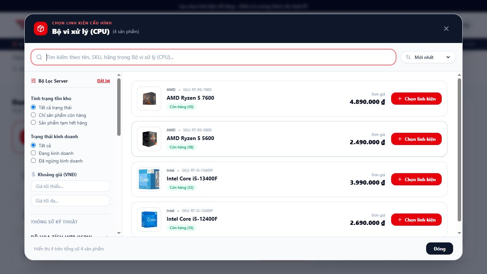
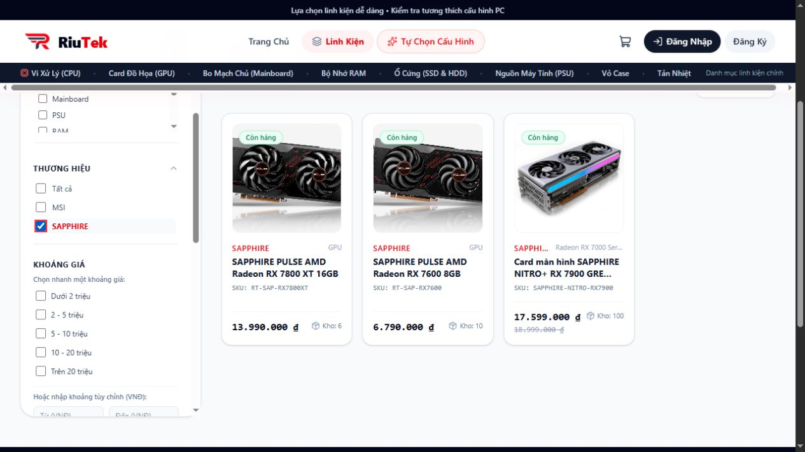
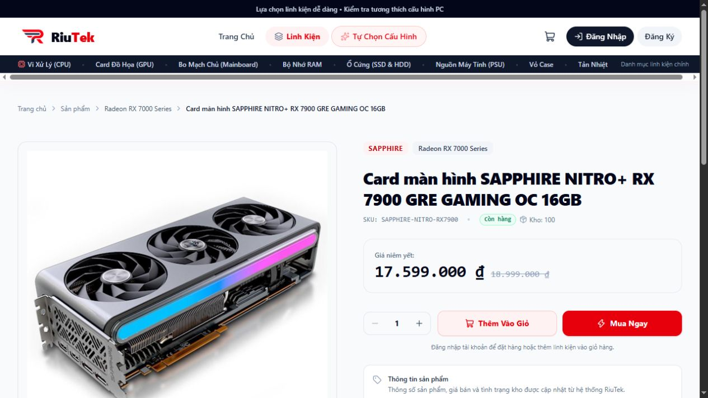

<div align="center">
  
  <h1>RiuTek Web</h1>
  <p>Find your components. Put your PC together.</p>
  <p>
    <a href="https://riutek.store">Live website</a> &nbsp;·&nbsp;
    <a href="https://github.com/RiuTek/RiuTek_API">Backend repository</a> &nbsp;·&nbsp;
    <a href="#try-the-demo">Try the demo</a>
  </p>


</div>

---

RiuTek is a personal e-commerce project for buying PC components and choosing parts for a custom build. This repository contains the React storefront, an AI shopping chat and a role-protected administration area.

> **Try it online** — Browse components and export a PC build without an account at [riutek.store](https://riutek.store). Sign in to save builds and try checkout. Stripe uses test mode.

[Screenshots](#screenshots) · [Features](#features) · [AI assistant](#ai-shopping-assistant) · [Technology](#technology) · [API integration](#api-and-authentication) · [Setup](#run-locally) · [Build](#checks-and-build) · [Roadmap](#roadmap)

## Screenshots

**PC Builder**



| Catalog filters | Product detail |
| :---: | :---: |
| [](docs/screenshots/catalog-filters.jpg) | [](docs/screenshots/product-detail.jpg) |

## Features

| Feature | What you can do |
| :--- | :--- |
| **Browse components** | product search, nested categories, technical checkbox filters, sorting, pagination and image galleries. |
| **Build a PC** | choose components, review compatibility findings and estimated power requirements, and download a configuration as a PNG. Guests can use the builder without an account; customers can save and revisit their builds. |
| **Ask the AI assistant** | signed-in customers, Staff and Admin can ask product questions, see recommendations with images and catalog links, and request a PC configuration by need and budget. Follow-up changes can preserve selected parts or adjust the budget. |
| **Shop and order** | persistent account carts, selection of cart items for checkout, Buy Now for a product or saved build, delivery addresses, COD and Stripe Checkout in test mode. |
| **Manage an account** | registration, sign-in, profile/address updates, saved configurations and order history with the actions supported by each order's state. |
| **Administer the store** | Admin/Staff screens for categories, products, stock adjustments, Excel imports, orders and homepage banners. Bulk import accepts an Excel workbook and an image folder, matching files by SKU before upload to R2. |
| **Browse the homepage** | administrator-managed banner carousel, product rows loaded from the catalog and illustrated promotional side banners on wide screens. |

Compatibility messages provide guidance; they do not guarantee that every build is suitable. Stock and price checks remain separate from hardware compatibility. The PNG is generated in the browser and is not uploaded or stored by the backend.

## AI shopping assistant

The floating chat stays available while signed-in users browse the storefront. It supports Vietnamese questions about products, specifications, availability and choosing components. Replies show product images, prices, stock status and links, with manufacturer sources when the backend has verified external evidence.

For a PC request, the backend returns one configuration within the stated budget and checks it with the existing hardware compatibility service. The chat displays each component and the amount still to buy. Already-owned parts have a separate label and are excluded from that amount.

Choose **Mở trong PC Builder** to edit the proposal. The builder fetches current prices, stock and compatibility, and asks before replacing an existing draft. Follow-ups such as **“Giữ CPU, nâng GPU”** and **“Giảm xuống 20 triệu”** refer to the latest proposal. Starting a new conversation clears that context and the displayed chat history.

Suggested questions fill the input for review before sending. Enter sends a message, and Shift + Enter adds a line break. When the API reports an exhausted quota, the chat explains the limit and, when available, displays when sending can resume. Conversation resets retain the current quota restriction.

Guest AI access is disabled in the deployed configuration. Requests go through the backend, which keeps the Groq credentials, queries the catalog and enforces access and usage limits. Recommendation ranking uses catalog prices and specifications; benchmark/FPS predictions are outside the current release.

## Technology

| Area | Stack |
| :--- | :--- |
| Application | React 19, TypeScript, Vite |
| Navigation | React Router |
| Interface | Tailwind CSS, Lucide icons |
| Build image export | Native Canvas 2D |
| AI integration | Typed chat API, bounded recent history and previous-build context, backend Groq integration |
| Hosting | Vercel, API proxy to Azure App Service |

| Source | Purpose |
| :--- | :--- |
| `src/features` | Catalog, PC Builder, account, checkout and administration features |
| `src/layouts` | Shared page layouts |
| `src/components` | Shared UI components |
| `src/app/router.tsx` | Route definitions |

## API and authentication

The client calls relative /api/v1 endpoints. In the Vercel deployment, vercel.json proxies these requests to the Azure-hosted backend and serves the SPA for frontend routes.

Access tokens are held in memory, not localStorage or sessionStorage. Refresh tokens are handled by Secure, HttpOnly cookies. Backend authorization is required for protected operations; frontend route guards do not replace it.

R2 uploads use backend-issued presigned URLs: the browser uploads the image directly and confirms it with the API. R2 credentials remain on the backend.

Chat requests use the same relative API proxy and in-memory access token. Chat history is held in component memory and clears when the account changes or the user starts a new conversation. PC Builder drafts use the existing account-scoped session-storage flow with a one-hour lifetime.

## Run locally

Use a Node.js version supported by the Vite version in package.json, then run:

```sh
npm ci
npm run dev
```

The example environment variable is:

```text
VITE_API_BASE_URL=/api/v1
```

The client expects a relative API base URL. Vercel rewrites do not run automatically under the Vite development server or vite preview. Running the full application locally therefore requires an equivalent API proxy and a cookie-compatible HTTPS setup. The deployed website is available for trying the complete integration; starting Vite alone does not configure the backend connection.

Do not put database connection strings, JWT signing keys, Stripe secrets, R2 credentials or other backend secrets in VITE variables. These variables are included in the public browser bundle.

## Checks and build

```sh
npm run lint
npm run build
npm run preview
```

The production build is generated in dist. The Vercel project deploys the main branch; its /api rewrite must precede the SPA fallback.

## Try the demo

1. Browse products and filter by a component group.
2. Open the PC Builder, select components and download the configuration image. No sign-in is needed for these steps.
3. Register a customer account to save configurations, manage a cart and try the order flow.
4. Open **Hỏi tư vấn AI**, ask for a gaming PC within a budget, and try keeping the CPU while changing the GPU or lowering the budget.
5. Open the AI proposal in PC Builder, review the updated information and adjust a component.
6. Review the resulting order in the account's order history.

Stripe runs in test mode. The site demonstrates checkout and order workflows; it is not presented as a live retail service. Administrative accounts are not published in this repository.

The static side-banner illustrations are promotional artwork. They link to PC Builder and the product catalog and are maintained in the frontend. They are separate from the administrator-managed homepage carousel. Asset details are documented in [Banner artwork](docs/banner-artwork.md).

## Roadmap

The current web release covers the storefront, PC Builder, AI shopping assistant, account/cart/checkout flows and store administration listed above.

Future work includes customer-facing posts, comments and reviews screens using the existing backend APIs, semantic product search, benchmark-backed AI ranking, VNPay integration, and laptop/prebuilt-PC catalog support.
